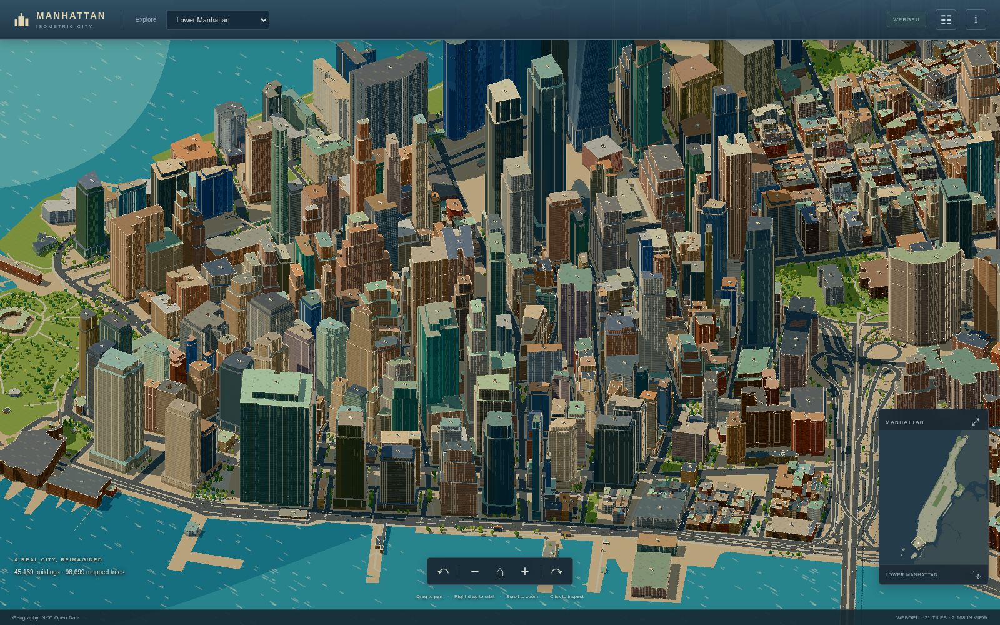

# Manhattan — Isometric City

A SimCity-inspired, interactive 3D miniature of **the whole Manhattan borough**,
built from real NYC geographic data. Coverage includes the source borough's
islands and Marble Hill. The viewer streams local data files; it needs **no map
API key or live map service**.



The checked-in snapshot contains **45,169 real building polygons, 98,699 recorded
standing trees, 16,237 street/bridge/path pieces, and 747 land/park pieces**.
Building geometry uses official footprints and roof heights. Ten selected
landmarks have recognizable, approximate roof/crown silhouettes; facades and
other decorative details are procedural artwork.

## Run and build

Requires Node.js 22.12+ or a compatible newer release.

```bash
npm ci
npm run dev
```

Open the local URL printed by Vite, normally `http://localhost:5173/`.

```bash
npm run build
npm run preview
```

The production output is `dist/`, suitable for a static web host. Its data files
are copied from `public/data/manhattan/`. Allow roughly **104 MB** for the complete
uncompressed geographic hierarchy; visitors download selected tiles as needed.

For a public port with compressed tile delivery:

```bash
python3 scripts/compress_assets.py dist
python3 scripts/serve.py --port 5173 --directory dist
```

This listens on `0.0.0.0:5173`. Use HTTPS through your reverse proxy or tunnel
for WebGPU. The current bundle compresses to approximately **18 MB** for all
levels together; a neighborhood downloads only its selected subset.

The renderer defaults to **Three.js WebGPU**. If WebGPU is unavailable, the app
identifies its **WebGL2 compatibility fallback** in the interface. WebGPU requires
a supporting browser/device and a secure context such as HTTPS or localhost.
Frame rates depend on hardware, browser, scene density, and settings; no device
FPS target is guaranteed.

## Explore

- **Left-drag to pan, right-drag to orbit, scroll to zoom.** On touch devices,
  drag with one finger to pan and use two fingers to zoom/rotate.
- Jump between Midtown, Lower Manhattan, Greenwich Village, Central Park, Harlem,
  Inwood, and the full-borough overview. Click the minimap to move across the city.
- Click buildings to inspect their source identity and height; double-click to
  focus. Selection operates on currently loaded buildings.
- Adjust time of day, traffic, trees, pixelation, and ambient occlusion in settings.
- Keyboard: `Q` / `E` rotate, `+` / `-` zoom, `R` returns to Midtown. With the
  canvas focused, `[` / `]` cycle loaded buildings. `Escape` clears selection or
  closes settings.

The visual pipeline includes orthographic navigation, **18 procedural facade
styles**, per-building color and window-spacing variations, four-band cel
lighting, crisp cast shadows, and three-tone animated water. Glass uses drawn
reflection bands; masonry and roofs use procedural surface textures. Building
colors stay consistent across detail levels, with vertex tints sharing the same
material batches. Pixelation, ambient occlusion, batched building geometry, and
instanced trees/vehicles complete the scene. Decorative traffic follows
mapped street segments; it is not live traffic or a connected transport model.

## Coverage and streaming

The geographic frame uses an azimuthal equidistant projection centered on
**40.7831° N, 73.9712° W**. Data coordinates are meters, **x east and y north**;
the renderer maps north to negative z.

| Extent | Bounds |
| --- | --- |
| Longitude/latitude envelope | West −74.047730°, south 40.682917°, east −73.906651°, north 40.879038° |
| Local meter envelope | x −6,468.92 to 5,442.11; y −11,123.91 to 10,655.76 |

The manifest indexes three aligned spatial levels:

| Level | Tile size | Tiles | Content |
| --- | ---: | ---: | --- |
| LOD0 | 500 m | 350 | Full footprints, streets/paths, parks, recorded trees |
| LOD1 | 1,000 m | 109 | Simplified footprints, broader roads, no trees |
| LOD2 | 2,000 m | 39 | Further simplified footprints and selected broad roads |

Each level retains the same **45,169 building identities**. Complete building
silhouettes belong to the tile containing their centroid and can cross tile
edges; they are never sliced at seams. Road and land geometry is clipped per
tile. Tile feature coordinates remain in the common geographic frame, with an
origin supplied for local rendering precision.

The viewer selects visible detail according to projected screen size and uses an
LRU cache capped at **72 tiles**, with **four concurrent loads**. At most
**16 full-detail tiles** appear at once. Tile frustum tests
use actual content bounds and maximum heights, and distant water ripples fade
to avoid subpixel shimmer. The overview keeps Manhattan's shoreline visible while
detail streams. Muted context
land comes from real Bronx, Queens, Brooklyn, and Staten Island shoreline
polygons. New Jersey context is not included.

## Geographic sources

| Layer | Official source |
| --- | --- |
| Building footprints and roof heights | [NYC OTI Building Footprints](https://nycmaps-nyc.hub.arcgis.com/datasets/nyc::building/about) |
| Streets, bridges, and available widths | [NYC Street Centerline / CSCL](https://data.cityofnewyork.us/d/inkn-q76z) |
| Land and shoreline | [NYC DCP Borough Boundaries, water excluded](https://data.cityofnewyork.us/d/gthc-hcne) |
| Park/property polygons | [NYC Parks Properties](https://data.cityofnewyork.us/d/enfh-gkve) |
| Tree positions and species | [NYC Parks Forestry Tree Points](https://data.cityofnewyork.us/d/hn5i-inap) |
| Selected landmark identification | [NYC LPC Building Database](https://data.cityofnewyork.us/d/gpmc-yuvp) |

Source URLs, acquisition timestamp, counts, and interpretation notes are embedded
in the manifest. Preserve NYC attribution and review source metadata/terms when
redistributing the data. No commercial basemap, Google 3D tiles, original game
artwork, or generated map images are bundled.

## Rebuild the data

```bash
python3 -m venv /tmp/nyc-geodata-venv
/tmp/nyc-geodata-venv/bin/pip install -r scripts/requirements-geo.txt
/tmp/nyc-geodata-venv/bin/python scripts/build_manhattan.py --cache /tmp/nyc-manhattan-cache
/tmp/nyc-geodata-venv/bin/python scripts/validate_manhattan.py
```

The builder caches source responses for resumable downloads and checks every
downloaded page against its source count. Use `--acquire-only` to download without
generating tiles. Preserve the cache for repeatable development; remove it to
acquire refreshed source records. Counts can change when NYC updates its data.
See [scripts/README.md](scripts/README.md) for schema and pipeline details.

The earlier 1 km² Battery/Financial District pilot remains at
`public/data/city.json`; `scripts/download_city.py` rebuilds that older crop.
The whole-borough viewer uses `build_manhattan.py` and the Manhattan manifest.

## Accuracy and interpretation

- Roof heights are official `HEIGHT_ROOF` feet above ground, converted to meters.
  **70 missing/zero heights use explicitly marked estimates.** Floor counts are
  always estimates from height. Five placeholder footprint triangles are excluded.
- Terrain is flat. Source ground elevations remain attributes; sloping streets,
  bridge deck elevations, interiors, and detailed engineering structures are not
  reconstructed. Real bridge centerlines retain their spans over water.
- Roof setbacks, spires, windows, storefronts, and rooftop equipment are artistic
  approximations. This generation does not use the older 2014 CityGML roof model.
- Tree locations/species are recorded standing-tree inventory data, deduplicated
  by planting space. Tree dimensions are stylized; the inventory is not a claim
  that every tree in Manhattan is represented. Parks identify property boundaries,
  not exact grass coverage.
- Geographic sources have different survey/update dates. This is a collection of
  public-data snapshots, not a synchronized current survey.

The visual direction draws on classic isometric city games and
[Isometric NYC](https://cannoneyed.com/projects/isometric-nyc).

## Validation

The geographic validator checks every tile's polygon validity, clipped road/land
bounds, complete and unique building membership across all levels, and tree
membership. It passes for the checked-in 498-tile hierarchy.

Browser tests use Playwright:

```bash
npx playwright install chromium
npm test
```

All three tests pass: full dataset membership across levels; native WebGPU
rendering, pointer selection, settings, neighborhood navigation, whole-island
coverage and cache eviction; and mobile controls/source disclosure.

Rendering was validated on **NVIDIA WebGPU with Chrome 158** in this container's
desktop display. Its headless SwiftShader WebGPU implementation loses the device
even in a minimal raw-WebGPU test, so headless software rendering is not the
validation path used here. The test configuration accepts `CHROMIUM_EXECUTABLE`,
`CHROMIUM_GPU_FLAGS`, and `PLAYWRIGHT_HEADFUL=1` for an installed GPU-capable browser.
These checks do not establish a general hardware FPS target; profile the intended
visitor devices before making performance guarantees.

## Files

- `src/main.js`: WebGPU setup, camera, selection, lighting, and interface.
- `src/tiles.js`: spatial LOD selection, concurrent loading, and LRU tile cache.
- `src/world.js`: geographic geometry, landmark silhouettes, trees, and traffic.
- `src/materials.js`: procedural facade styles, ground materials, and node water.
- `public/data/manhattan/manifest.json`: coverage, attribution, overview, and tile index.
- `scripts/build_manhattan.py`: cached acquisition and full-borough tile generation.
- `scripts/validate_manhattan.py`: geographic and hierarchy validation.
